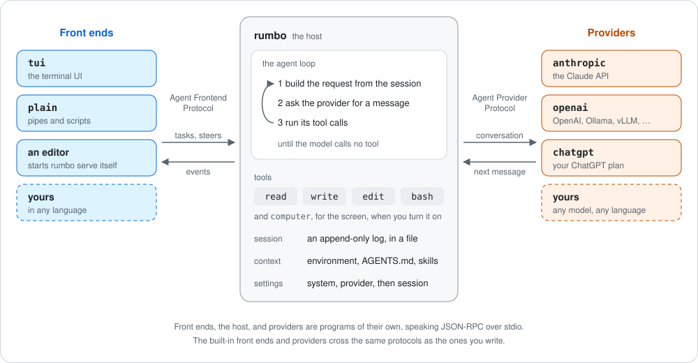

# rumbo

A minimal agent harness. Give it a task, and it works through four tools
(`read`, `write`, `edit`, `bash`) until the model is done. The models behind
it and the interfaces in front of it are separate programs you can replace.



## What makes it different

- **Any model, any interface, any language.** Providers and front ends are
  programs that speak a small JSON-RPC protocol over stdio. The built-in
  ones use the same protocols as the ones you write; none gets a shortcut.
- **History you can replay.** A session is an append-only log in SQLite.
  Every request sent to the model can be rebuilt from it, a run that failed
  or was cut short resumes where it stopped (`rumbo -r`), and `/branch`
  goes on from before any of your messages in a new session, while the
  first one stays as it was.
- **Built for the provider's cache.** Each request extends the one before
  until a summary starts the conversation over, so the provider can read it
  from its cache; a test guarantees it.
- **One host, many sessions.** Runs go on in other sessions while you work
  in a new one, and you can tell a run something without stopping it.
- **Providers describe themselves.** Their models, options, and functions,
  down to a sign-in that asks you for a code, show up in every front end
  without the front end knowing them.
- **Small and general.** A short fixed system prompt, nothing about any
  language or framework, no telemetry. It knows no kind of work: it does
  what your task and your `AGENTS.md` ask, programming or not.

By design it does not judge the model's work, send context nobody asked
for, or limit what the agent may do.

## Where it comes from

- **[pi](https://pi.dev)**, the minimal agent harness Mario Zechner started,
  for what a harness leaves out. Like pi, rumbo gives the model four tools
  and a short system prompt, and has no plan mode, no subagents, and no
  permission prompts: a shell reaches everything else, and what a task needs
  comes from the task and your instructions.
- **The [Language Server Protocol](https://microsoft.github.io/language-server-protocol/)**,
  for how the parts meet. LSP lets any editor support any language by making
  the two separate programs that speak JSON-RPC and say, on `initialize`,
  what each can do. rumbo does the same on both sides of the loop: front ends
  and providers are programs that speak JSON-RPC with the host, describe
  their options and functions when they start, and can be written in any
  language.

## Before you run it

rumbo gives the model your rights: it reads, writes, and runs commands as
you, without asking and without a sandbox. What the model reads, such as a
project's `AGENTS.md`, its files, or command output, can steer it, so work
on code you do not trust inside a container or a virtual machine. Sessions
keep what the model saw, secrets in command output included, in
`~/.local/share/rumbo/rumbo.db`. An API key you give a built-in provider's
`/login` is kept in `~/.config/rumbo/credentials/`
(`~/Library/Application Support/rumbo/credentials/` on macOS), readable only
by you, and so by the model too. rumbo itself contacts no server: only your
providers and the model's commands reach the network.

## Install

Download the archive for Linux or macOS from the
[releases](https://github.com/LiasCode/rumbo/releases), or:

```sh
go install github.com/LiasCode/rumbo/cmd/rumbo@latest
```

Windows is not supported.

## Start

```sh
export ANTHROPIC_API_KEY=...                      # or /login in the terminal UI, or `ant auth login`
rumbo system set default_provider anthropic       # what new sessions start with
rumbo system set default_model claude-opus-5-5

rumbo "add a --json flag to the export command"  # one task, in this directory's project
rumbo                                            # the terminal UI; /help lists its commands
rumbo -c "also document it"                      # continue the latest session
rumbo -r                                         # resume a run that stopped
rumbo "summarize notes.md" > summary.txt         # piped: plain text out, exit code
```

Any server compatible with OpenAI's Chat Completions, local ones included,
works through the built-in `openai` provider:

```sh
rumbo provider add -config '{"base_url":"http://localhost:11434/v1"}' local '{self}' provide openai
rumbo provider config local context_window=32768   # a server cannot say its context size
rumbo -p local -m qwen3-coder "fix the failing test"   # the session keeps them
```

The `openai` provider rumbo registers speaks OpenAI's Responses API, which
its reasoning models need to use tools with an effort. One registered by an
earlier version speaks Chat Completions until
`rumbo provider config openai api=responses`.

The model also reads your instructions: the `AGENTS.md` or `CLAUDE.md` files
from the project's root down to where you are, and yours in
`~/.config/rumbo/` (`~/Library/Application Support/rumbo/` on macOS).

## Bring your own

- **A provider** answers `initialize` and `complete` on its stdin and
  stdout. Start from [examples/provider.py](examples/provider.py); the
  specification is [docs/protocol.md](docs/protocol.md).

  ```sh
  rumbo provider add mine /path/to/my-provider
  rumbo -p mine -m some-model "..."
  ```

- **A front end** is started by rumbo with the protocol on file descriptors
  3 and 4 (`rumbo frontend add mine ...`, then `rumbo -f mine`), or starts
  `rumbo serve` itself, as an editor would. Start from
  [examples/frontend.py](examples/frontend.py); the specification is
  [docs/frontend-protocol.md](docs/frontend-protocol.md).

## Learn more

- `rumbo help`, `rumbo system`, and `rumbo provider`: the commands, the
  system settings, and each provider's configuration and options.
- [docs/use-cases.md](docs/use-cases.md): everything the host, providers,
  and front ends can do.
- [docs/architecture.md](docs/architecture.md) and
  [docs/glossary.md](docs/glossary.md): how the parts fit, and the terms.
- [CHANGELOG.md](CHANGELOG.md): what each release changes. Until 1.0,
  commands and settings may change; the protocols stay at version 1 and only
  grow, and stored sessions and settings keep working.

## License

MIT; see [LICENSE](LICENSE).
