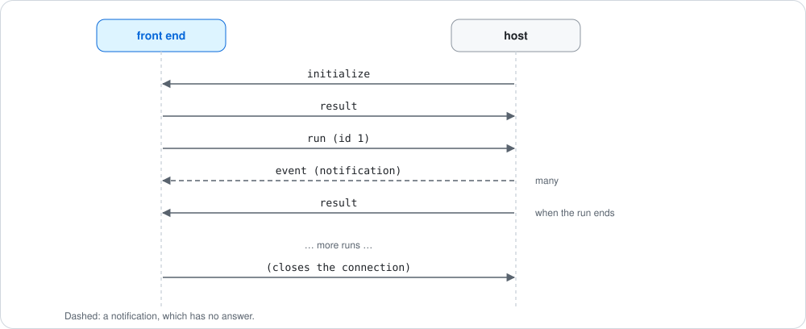

# Agent Frontend Protocol

Version 1.

The protocol connects a **front end** to the rumbo host. A front end is what a
person uses: it sends objectives and shows what the agent does. The host owns
the session, the tools, and the loop, and shows nothing itself.

The Go types are in the [`protocol`](../protocol) package (`frontend.go`),
which also contains `DialFrontend`, a ready-made connection for front ends
written in Go, and `DialFrontendConfigured` for one with a start
configuration, which answers with the configuration in force. [examples/frontend.py](../examples/frontend.py) is a front end
in Python.

## Transport

Messages are JSON-RPC 2.0 objects, **one per line**, UTF-8. There are two
ways to be connected, with the same messages on both:

| Who starts whom | The front end reads from | The front end writes to |
|---|---|---|
| `rumbo` starts a registered front end | file descriptor 3 | file descriptor 4 |
| The front end starts `rumbo serve` | the host's stdout | the host's stdin |

A registered front end keeps stdin, stdout, and stderr connected to the
terminal, so it can draw and read keys freely. A front end that starts
`rumbo serve` passes it the same flags as `rumbo` (`-c`, `-r`, `-s`, `-p`,
`-m`, `-o`, `-single`) and sets its working directory to the project.

Closing the connection ends the host: it cancels the runs in progress, stops
the providers, and exits. SIGTERM and SIGHUP end it the same way, and close
the connection. The exit code of a registered front end becomes the exit
code of `rumbo`, unless a signal ended the host.

Requests are handled in the order they arrive. What reaches a provider is
answered when it is done, without holding up what comes after it: a `run`
is accepted in order and answered when it ends, and `describe`, the
provider's functions, and the host's functions that ask a provider,
`session-set`, `session-values`, `compact`, `provider-models`,
`provider-show`, `provider-set`, `provider-values`, and `provider-add`, are
answered when the provider has, and those that start the extensions,
`extension-show`, `extension-set`, and `extension-add`, when they have. A `history`, a `recall`, and the host's
other functions are answered at once, before the request after it. A front
end that needs one of those to take effect before another request waits
for its answer.

## Sessions

A host works in the sessions of one project. One of them is the **current
session**: the one `initialize` names, the one a run goes to when it names
none, and the one the host's functions act on by default. A run can also
name another session of the project, or ask for a new one; each session has
one run at a time, and several sessions can work at once.

Started with `-single`, the host works in one session at a time: runs go
only to the current session, and changing session waits for the run in
progress to end.

## Lifecycle



## Methods

### `initialize` (request, host to front end)

The host speaks first.

```json
{"jsonrpc":"2.0","id":1,"method":"initialize","params":{
  "protocol": 1,
  "dir": "/home/me/project",
  "session": "4cf0261c",
  "provider": "anthropic",
  "model": "claude-opus-5-5",
  "objective": "fix the failing test",
  "config": {}
}}
```

- `session` is the current session, absent when it is a new one; the first
  `run` that works in it carries its id in its events and its result.
- `model` is empty when nothing chose one yet: a provider has no model set
  for it, and the command line gave none. A run is refused until one is
  chosen, with `use` or with the run's own `model`.
- `objective` is what the user already wrote on the command line, if anything.
  A front end is expected to run it without asking again.
- `resume` is `true` when the user asked to continue the session's unfinished
  run (`rumbo -r`). A front end is expected to send a `run` with `resume`.
- `config` is what the user chose for the front end (`rumbo frontend
  set`, or its `config` in rumbo's `config.yaml`), as JSON. Its meaning is
  the front end's own.
- `functions` are what the host itself can be asked, whatever the provider.
  See [Functions of the host](#functions-of-the-host).

Result: `{"protocol":1,"name":"my-frontend","config":{}}`.

`config` in the result is the start configuration in force: the one given,
with the front end's own default for every field it was not given. The host
stores none of it: only what the user chose is kept. Nor does it check what
the user chose, since a front end needs its terminal to start: a front end
refuses a field it does not have, or a value it cannot use, and says why,
as rumbo's own do.

### `run` (request, front end to host)

```json
{"jsonrpc":"2.0","id":1,"method":"run","params":{"objective":"add a --json flag"}}
```

Starts a run on `objective`. Instead of an objective, `{"resume": true}`
continues the session's last run where it stopped: one that failed, was
cancelled, or was cut short by the host dying. It is an error when the last
run finished.

`images` are pictures the person gave with the objective, such as one
pasted: a list of `{"media_type": "image/png", "data": "<base64>"}`, as in a
tool's result (see [protocol.md](protocol.md#content-blocks)). They go to
the model with the objective, and come back with the summary when the
conversation is compacted. A run of images alone, with no objective, is
taken too. The host prepares each one for the model, made smaller when it
is large, and refuses the run when one is not a PNG, JPEG, GIF, or WebP
image.

Where it runs is the current session, unless the request says otherwise:
`session` names another session of the project, and `"new": true` starts a
new one, which keeps the provider of the current session. Neither changes
the current session. A run in a session that is already working is refused
with a JSON-RPC error, as is one in another session under `-single`.

Two optional fields choose, for this run, among what the provider offers:
`model`, and `options`, an object of option values. What is left out keeps
the value in force in the session, which `describe` reports for the current
one. A run in a session without a model, and with none of its own, is
refused.

The result arrives when the run is over, however it ends:

```json
{"status":"done","session":"4cf0261c"}
```

| `status` | Meaning |
|---|---|
| `done` | The model finished the task. |
| `failed` | The run ended with a problem; `error` explains it. |
| `cancelled` | The front end cancelled it. |

Other requests can be sent while runs work, without waiting for their
results; each answer carries the id of its request. A run is named by the id
of its `run` request in its events, in `cancel`, and in `steer`, so a front
end should not reuse the id of a run in progress.

### `describe` (request, front end to host)

```json
{"jsonrpc":"2.0","id":2,"method":"describe"}
```

Asks what the provider of the current session offers and what is in force
there. It is how a front end shows a model picker or a settings form for a
provider it knows nothing about.

```json
{"provider": "anthropic",
 "model": "claude-opus-5-5",
 "options": {"effort": "high"},
 "offers": {
   "model": {"type": "string", "values": "models"},
   "options": [{"name": "effort", "type": "string", "enum": ["low", "medium", "high"]}],
   "functions": [{"name": "models", "description": "List the models this account can use"}]}}
```

- `model` and `options` are what a run in the current session uses unless
  it says otherwise: the session's model, and the values the provider's
  configuration gives its options, with those chosen in the session over
  them. `use` changes the model for the session, and `session-set` the
  options.
- `offers` is the provider's own description, passed on unchanged. Its format
  is specified in [the provider protocol](protocol.md#describing-the-provider).
  Any part of it may be absent.
- `extensions`, when there are any, are the extensions that offer functions:
  `[{"name": "notes", "functions": [...]}]`, each function described as a
  provider's is. A front end offers them as commands too; since two
  extensions can each have a function called the same, it names each
  command after its extension, as the terminal UI's `/notes-forget`.

The first `describe` starts the provider, so it can fail for the same reasons
a first run can. It starts the extensions too; when they do not all start,
a `log` event says why, and the answer has no `extensions`.

### `history` (request, front end to host)

```json
{"jsonrpc":"2.0","id":4,"method":"history","params":{"session":"4cf0261c"}}
```

Asks what a session holds: the current session's without `session`, or
another of the project's. The answer tells it in events, oldest first, the
same events its runs sent while they worked, so a front end can show a
session it opens as if it had followed every run:

```json
{"session": "4cf0261c",
 "events": [
   {"type":"objective","session":"4cf0261c","text":"fix the failing test"},
   {"type":"text","session":"4cf0261c","text":"Let me look"},
   {"type":"turn","session":"4cf0261c","usage":{"input":900,"output":40},"context":940},
   {"type":"ended","session":"4cf0261c","status":"done"}]}
```

The events name no run, since run ids belong to the connection that sent
them. Three types appear only here, for what a front end otherwise knows of
the runs it follows itself: `objective`, `steer`, and `ended`. Text comes
whole rather than in pieces, a tool call is told when its result is, and
one that never got a result is told as started. A new current session
holds nothing yet: its `session` is absent and `events` is empty.

A history asked for before a `run` is answered before the run starts, so
none of the run's events are missing from it or told twice.

### `recall` (request, front end to host)

```json
{"jsonrpc":"2.0","id":5,"method":"recall","params":{}}
```

Asks what the person asked in the project's sessions, so a front end can
bring it back to its input. The answer holds the objectives and what was
said to runs while they worked, most recent first, each text once, up to
the last thousand:

```json
{"asked": ["and its tests", "fix the failing test"]}
```

It comes from the sessions themselves: what a deleted session held is gone
from it too, and the answers to a provider's questions, which are never
recorded, are never in it. A host without it answers that the method is
not found, and a front end goes on without.

### `invoke` (request, front end to host)

```json
{"jsonrpc":"2.0","id":3,"method":"invoke","params":{"name":"models"}}
```

Calls a function the provider of the current session described, with
`params` if it takes any. The host relays the call and the answer without
reading either. A function that
an option names in `values` answers with `{"values": [{"value", "label",
"description"}]}`; any other answers with JSON of its own.

A front end that lists the values of a parameter calls the function its
`values` names with what was given for the parameters before it, those the
function takes, so what it lists can depend on them: after the `provider`
of `use`, the models of that provider.

With `"target": "host"` the call goes to a function of the host instead; see
[Functions of the host](#functions-of-the-host). With `"target":
"extension"` and `"extension": "notes"` it goes to a function of that
extension, which answers and talks as a provider's does.

Runs do not keep `describe` and `invoke` waiting: a provider answers one
request at a time, so the host starts another process of it when every one
it has is busy.

A function of a provider or of an extension can talk with the person
while it works, as a login does. What it says arrives as `text` events whose `invoke` is the id of this
request, and what it asks as an [`ask`](#ask-request-host-to-front-end).
It takes as long as the person does; `cancel` with its `invoke` gives it
up.

### `ask` (request, host to front end)

```json
{"jsonrpc":"2.0","id":2,"method":"ask","params":{"invoke":3,"text":"Paste the code the page shows","secret":true}}
```

A question for the person, from the function of the `invoke` request `invoke`.
The front end shows it and answers with what the person typed:

```json
{"jsonrpc":"2.0","id":2,"result":{"text":"4711-0815"}}
```

or with an error when the person declines. With `secret` the answer, such as
a password, is not shown while it is typed, nor kept afterwards. A front end
that is not following that `invoke` answers with an error. The host does not
record questions or answers.

A tool the model called can ask too, while it works: a tool of an extension
that asks before it runs a command, for one. The question then names no
`invoke`, but the run, its session, and the tool:

```json
{"jsonrpc":"2.0","id":5,"method":"ask","params":{"run":4,"session":"517cc41a","name":"bash","text":"Run `rm -rf build`?"}}
```

An error leaves the tool to decide what no answer means, and the run goes
on; so a front end nobody is at, such as one in a script, answers with one.
The question is over once it is answered or its run ends.

### `cancel` (notification, front end to host)

```json
{"jsonrpc":"2.0","method":"cancel","params":{"run":7}}
```

Stops the run whose `run` request had the id `run`; without it, every run in
progress. Each `run` request is still answered, with the `cancelled` status.
The sessions stay usable.

With `invoke` instead, it gives up a function in progress, named by the id
of its `invoke` request, which then answers with an error.

### `steer` (request, front end to host)

```json
{"jsonrpc":"2.0","id":9,"method":"steer","params":{"run":7,"text":"use the v2 endpoint instead"}}
```

Tells a run something while it works: the run whose request had the id
`run`, or without it the only run in progress. The text reaches the model
before its next request, as the user's words, and the run's objective stays
as it was. If the model was about to finish, the run goes on so the model
reads it. `images` go with the text, or alone, as they do with `run`.

The result, `{}`, arrives once the text is recorded for the model. An error
means it never will be: the run is not in progress, several are and none was
named, or the run ended first. A front end can offer the text as a new `run`
then.

### `event` (notification, host to front end)

```json
{"jsonrpc":"2.0","method":"event","params":{"type":"text","run":7,"session":"4cf0261c","text":"Let me look"}}
```

What is happening in a run. `run` is the id of its `run` request and
`session` the session it works in, which tells a front end the id of a new
session from the run's first event. A provider's diagnostics belong to no
run and carry neither; the work of `compact` carries only `session`. `type`
selects the other fields:

| `type` | Fields | Meaning |
|---|---|---|
| `context` | `sections` | Ambient context sent to the model, by section name. |
| `text` | `text` | A piece of the model's visible answer, in order. With `invoke` instead of `run`, something a function of a provider or of an extension says while it works. |
| `tool_started` | `name`, `args` | The agent calls a tool. |
| `tool_progress` | `name`, `text` | What a call in progress says it is doing, when its tool says. Not kept, and not in a history. |
| `tool_finished` | `name`, `result`, `failed` | The call ended; `result` is what the model receives. |
| `turn` | `usage`, `context`, `window` | One model response finished. `usage` is what it cost; `context` is how many tokens the conversation takes now; `window` is how many the model holds, when the provider said. |
| `log` | `text`, `source` | A diagnostic. `source` is `provider` for the provider's own output, `extension` for an extension's, which starts with the extension's name, and `host` for what the host has to say, such as a request it retried or one that missed the provider's cache. |
| `objective` | `text`, `images` | The objective a run was given, and the images given with it. Only in a [history](#history-request-front-end-to-host). |
| `steer` | `text`, `images` | What the person told a run while it worked. Only in a history. |
| `ended` | `status`, `text` | How a run ended, with the `status` of a run result, and `text` saying why a failed run failed. Only in a history. |

A front end ignores event types and fields it does not know. New ones may be
added without a new protocol version.

## Functions of the host

Some things a person wants from any front end have nothing to do with the
provider: changing session, changing provider, seeing what a conversation
has cost, quitting. The host offers them as functions, described the same
way a provider describes its own, so a front end can turn them into
commands, menu entries, or buttons without knowing them beforehand. A host
that gains a function gives every front end a new command.

They arrive in `initialize`, as `functions`, each with a `name`, a
`description`, `params`, and a `group`. A parameter marked `optional` may be
left out; the table below shows those with a `?`. A function with a
`confirm` text cannot be undone: a front end shows that text and calls the
function only after the person agrees. A function marked `lists` is there
to list the values a parameter of another function takes, the one that
names it in `values`: a front end calls it for that parameter's values, and
need not offer it as a command of its own. They are called with `invoke`
and `"target": "host"`:

```json
{"jsonrpc":"2.0","id":5,"method":"invoke",
 "params":{"target":"host","name":"use","params":{"provider":"openai","model":"gpt-x"}}}
```

Parameters are an object of text values. Every answer has the same shape:

```json
{"text": "using openai/gpt-x",
 "values": [],
 "state": {"dir": "/home/me/project", "session": "4cf0261c", "provider": "openai", "model": "gpt-x"}}
```

- `text` is the outcome in words, for a person.
- `values` is set by a function that lists something, in the shape a
  provider's value functions use: `value`, `label`, `description`.
- `state` is what the front end is attached to after the call. A function may
  have changed it, so a front end takes its session, provider, and model from
  here instead of remembering them.

`group` says what a function acts on, so a front end can list them apart:

- `system`: rumbo itself, the same for every session and provider. What a
  session chooses for itself wins over its settings there.
- `session`: one session of the project, the current one unless another is
  named.
- `provider`: the providers, how each is started, and what is set for
  each: the model a new session starts with, and its configuration, which
  holds the option values it gets with every request.
- `extension`: the extensions, how each is started, what is set for each,
  and what each gives the model. A change to one applies to the runs that
  start after it, and may change the functions the extensions offer, so a
  front end asks `describe` again before it offers them.

A front end should not take a group it does not know for an error; more may
be added.

The functions of this version, by group:

| Function | Group | Parameters | What it does |
|---|---|---|---|
| `config` | system | | Shows what is chosen and what applies, the current session's choice first, then the system settings, the providers, and the front ends, each value with where it comes from: the session, `config.yaml`, rumbo's default, or how rumbo has a built-in program or a plugin brings it. It starts nothing, so a program's own defaults are not in it. |
| `system-set` | system | `change` | Changes a system setting, as `name=value`; an empty value gives it back to its default. It is checked first, and applies to the runs that start after it; `default_provider` and `frontend` from the next start. |
| `system-values` | system | | Lists the changes `system-set` takes. Marked `lists`. |
| `quit` | system | | Stops the providers and ends the host, which closes the connection. Runs in progress are cancelled. |
| `status` | session | `session`? | The session, the model, the size of the context, what was spent, and how much of the input came from the provider's cache. |
| `skills` | session | | Lists the skills the model is told of in the current session's directory, and those left out, with why. |
| `sessions` | session | `project`? | Lists the project's sessions, most recently used first, with how each one stands: how its last run ended, or that it works in this host or in another rumbo process, and its turns; with a `project`, by its root, that project's instead. |
| `projects` | session | | Lists the projects that have sessions, by their root, most recently used first, with how many each has, and marks this host's. A front end shows every project's sessions with them, and starts `rumbo serve` in the root of the one a person opens. |
| `open` | session | `session` | Makes another session of the project the current one. |
| `new` | session | | Makes the next task start a new session. |
| `branch` | session | `point`? | Makes a branch of the current session the current one: a new session with a copy of it, as it is, or as it was before the person's message numbered `point`. The session it came from stays as it is, and goes on working when it was; the files stay as they are. Without `point`, it answers with an error while a run works in the session. |
| `branch-points` | session | | Lists the person's messages in the current session, by number, which a branch can start before. Marked `lists`. |
| `delete` | session | `session` | Deletes a session of the project and its history, for good. Asks to be confirmed. |
| `rename` | session | `title` | Gives the current session a title of the person's own. |
| `prune` | session | `age`, `confirm`? | Lists the project's sessions not used in that long, such as `30d`; with `confirm` as `yes`, deletes them, for good, with their history. Those in use are kept. |
| `use` | session | `provider`, `model` | Changes the provider and the model of the current session for the tasks that follow. The session goes on, and keeps them. Options chosen in it for another provider are dropped. |
| `session-set` | session | `change` | Chooses, as `name=value`, a value of one of the provider's options for the current session, which keeps it over the provider's configuration; an empty value gives it back. The provider is asked what it describes, and an option it does not describe, or a value it does not take, is refused. |
| `session-values` | session | | Lists the changes `session-set` takes: the values of the current provider's options, those in force marked. Marked `lists`. |
| `compact` | session | `session`? | Replaces the conversation with a summary now. |
| `providers` | provider | | Lists the providers there are: those plugins bring, rumbo's own among them, and those registered. |
| `provider-models` | provider | `provider`? | Lists the models a provider offers, asking it; without a `provider`, the current session's, with the one it uses marked. The `model` of `use` lists its values with it. |
| `provider-show` | provider | `provider`? | Starts a provider and shows each of its settings, its model, the fields of its configuration, and its options, with the value that applies and where it comes from, its own defaults included, and what it offers. Without a `provider`, the current session's, with what the session chose over the rest. Also the test that it works. |
| `provider-set` | provider | `provider`, `change` | Sets, as `name=value`, a provider's model, a field of its configuration, or one of its options; an empty value gives it back to its default. The provider is started to check it: a name it does not describe, a value of another type or not among those it lists, and a configuration it does not start with are refused, and nothing is kept. |
| `provider-values` | provider | `provider` | Lists the changes `provider-set` takes for a provider: its models, and the values of its fields and options. Marked `lists`. |
| `provider-add` | provider | `name`, `command` | Registers a provider. The command is the program and its arguments, separated by spaces. The provider is started, which is the test that it works; one that does not start is not registered. |
| `provider-rm` | provider | `provider` | Removes a provider the user registered, or what they chose for one a plugin brings, which stays. Asks to be confirmed. |
| `extensions` | extension | | Lists the extensions there are: those plugins bring and those registered. |
| `extension-show` | extension | `extension` | Starts the extensions and shows how one is started, what is set for it, the tools of rumbo's it replaces, its sections, its functions, and its tools, with what declaring them adds to every request. Also the test that it works. |
| `extension-set` | extension | `extension`, `change` | Sets, as `name=value`, a field of an extension's configuration, or `replaces`, the tools of rumbo's it takes the place of, separated by commas; an empty value gives it back. The extensions are started to check it, and a configuration it does not start with, or a tool it replaces and does not declare, is refused, and nothing is kept. |
| `extension-values` | extension | `extension` | Lists the changes `extension-set` takes for an extension: the fields set for it, with the value in force, and `replaces`, with the tools it can replace. An extension does not describe its fields, so one not set yet is typed by name. Marked `lists`. |
| `extension-add` | extension | `name`, `config`?, `replaces`?, `command` | Registers an extension. The command is the program and its arguments, separated by spaces; `config` is its configuration, as a JSON object, and `replaces` the tools of rumbo's it takes the place of, separated by commas. It is started with the others, which is the test that it works; one that does not start, or whose tools the model cannot be given with theirs, is not registered. |
| `extension-rm` | extension | `extension` | Removes an extension the user registered, or what they chose for one a plugin brings, which stays. Its tools are gone from the next run. Asks to be confirmed. |

A front end should read the list from `initialize` and not from this table:
the table is what the host offers today.

A function waits only for the session it changes: `delete`, `compact`, and
`branch` without a `point` answer with an error while something works in
their session. `open` and `new` change the current session while a run goes
on in the one left behind, and `use` changes the provider for the session's
next runs, while a run in progress keeps the one it started with.

Under `-single`, what changes the session or the provider waits for the run
in progress instead, and answers with an error saying so: everything but
`config`, `system-set`, `system-values`, `quit`, `status`, `skills`,
`sessions`, `projects`, `branch-points`, `rename`, `session-values`,
`providers`, `provider-models`, `provider-show`, `provider-values`,
`provider-add`, `provider-rm`, and the functions of the `extension` group.

## What the host guarantees

- **It never uses the terminal.** Everything the user should see is an event
  or a result. A front end can own the screen completely.
- **It never acts on the terminal's interrupt.** Ctrl-C is the front end's to
  interpret; `cancel` is how to stop a run.
- **Everything is recorded.** The session is stored by the host as it
  happens, so a front end keeps no state it would need to restore.
